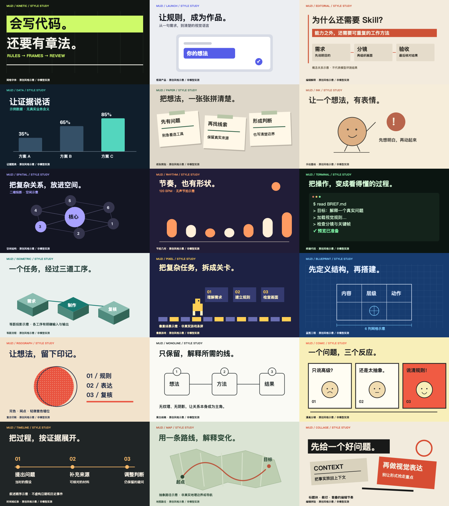

# 木子 · 视频风格导演

**让“高级一点”变成具体的画面、动作和验收标准。**

面向 Claude Code / Codex 等编码助手的中文视频制作 skill。围绕 Opus 5.5 代码视频生态做公开资料研究，独立编写 18 套风格规则与一条从简报到验收的工作流。

[下载单技能 ZIP](downloads/muzi-video-style-director.zip) · [发给智能体代装](publishing/agent-install.md) · [查看技能正文](skills/muzi-video-style-director/SKILL.md) · [公开来源](skills/muzi-video-style-director/references/sources.md)

## 先选一个抓眼的视觉方向

下图是**原作者作品参考，不是本 skill 的生成效果**。点击可查看原帖；原作不属于本仓库 MIT 许可，也没有打包进安装 ZIP。

| 全息光球 · AmazingUI | 金属字体 · Pixelbuddha | 霓虹微缩城 · Fabricio Rosa Marques |
|---|---|---|
| [](https://dribbble.com/shots/26539318-Sphere-AI-Assistant) | [](https://dribbble.com/shots/24025614-Glossy-Chrome-Text-Effect) | [](https://dribbble.com/shots/3760609-Isometric-Neon-City) |

[查看完整 6 组社交作品参考与原创制作建议](skills/muzi-video-style-director/references/visual-inspiration.md)，包括玻璃装置、彩色流体 UI 和像素魔法。六组是视觉参考，原有十八套风格规则仍保留。

## 直接发给智能体安装

不用自己敲命令。复制下面这段，发给有联网和文件权限的 Claude Code / Codex：

```text
请安装 https://github.com/muzilun000-gif/muzi-video-style-director
技能位于 skills/muzi-video-style-director。
识别当前平台的技能目录，完整保留 SKILL.md、references、assets 和 LICENSE。
已有同名技能先比较，不直接覆盖。安装后报告实际路径和是否已被识别。
如果无法安装，就读取 SKILL.md 及相关 references，在当前任务临时使用，说明未持久安装。
```

也可以把单技能 ZIP 发给智能体处理。[完整代装、临时使用与 ZIP 指令](publishing/agent-install.md)。安装技能不会自动提供模型订阅、视频引擎或平台发布权限。

## 包含什么

- **18 套风格配方**：字体动效、极简产品、编辑解释、证据图表、纸张剪贴、手绘墨线、空间结构、节拍几何、终端代码、等距流程、像素游戏、蓝图工程、复古印刷、黑白线稿、漫画分镜、时间线纪录、地图路径、编辑拼贴。
- **中文制作流程**：明确观众、核心信息、分镜、配色、字体、动作、声音及验收。
- **原创配图 + 离线画廊**：18 张 SVG，及可切风格、暂停、拖动时间的 HTML 动画预览。
- **6 组社交视觉参考**：保留原作者、原帖及画面拆解，给出更抓眼的原创实现方向。
- **14 个公开来源入口**：区分案例合集、实际 skill、动画框架和渲染引擎，并说明读取范围。
- **成本与结果边界**：不暗中调用付费 API；概念图、预览、MP4 和发布分别交代。

配图及画廊由本包代码绘制，属于视觉规则演示；不是原作者作品，也不是 Opus 5.5 实测视频。

<details>
<summary>查看十八种基础规则示意图</summary>



</details>

## 安装到 Claude Code

下载仓库 ZIP 并解压，打开终端进入解压后的本仓库目录。也可直接下载仓库 `downloads/` 中的单技能 ZIP，解压后得到 `muzi-video-style-director/`，再把它放入技能目录。

以下命令针对完整仓库 ZIP：

```bash
mkdir -p ~/.claude/skills
test ! -e ~/.claude/skills/muzi-video-style-director && \
  cp -R skills/muzi-video-style-director ~/.claude/skills/
```

若已存在同名文件夹，先比较版本，勿直接覆盖。新建 Claude Code 会话，输入：

```text
使用 muzi-video-style-director，做一个15秒竖屏解释片：
“AI会写代码，为什么还需要skill？”
风格用 kinetic，先给分镜和三张关键帧，再做动画。
不调用付费API，指标不要编造，交付源码并说明是否已导出MP4。
```

## 安装到 Codex

从目标项目目录，将仓库里的 `skills/muzi-video-style-director` 复制到项目的 `.agents/skills/`，保留完整文件夹。新开会话后使用 `$muzi-video-style-director`。

不要只复制 SKILL.md：`references/` 和 `assets/` 也要保留。网页对话环境是否支持上传 skill、运行浏览器和视频编码，取决于宿主能力；本包不保证所有 Claude 界面都可直接执行。

## 看效果

直接用现代浏览器打开 [`examples/gallery.html`](examples/gallery.html)，无需安装依赖或 API Key。选择十八种风格，拖动时间查看同一主题的不同处理方式。可导出当前画面为 PNG。

GitHub 文件页不会执行 HTML：请下载后打开。预览无音轨；音乐节拍只是视觉示意。HTML 不等于已渲染 MP4。

## 导出与依赖

本技能负责设计与工作流，**不内置完整 MP4 渲染引擎**。可沿用已有 Remotion / HyperFrames / Canvas 渲染项目，或让助手依据当前官方文档配置。模型订阅、引擎许可、字体、音乐、TTS 和编码时间分别核算。

没有额外付费 API 也能做代码图形，但不代表免费无限使用模型或一键稳定生成任意视频。

## 校验

```bash
python3 scripts/check_package.py
```

该检查覆盖包结构、相对引用与 SVG 格式；浏览器视觉检查、模型实测和 MP4 验收是独立步骤。

## 来源、许可与署名

[来源索引](skills/muzi-video-style-director/references/sources.md) · [完整技能](skills/muzi-video-style-director/SKILL.md) · [抖音脚本及回复话术](publishing/douyin-script.md)

本包新增文字、示例代码、SVG 配图采用 MIT 许可。仓库文件与安装 ZIP 未打包第三方媒体；README 和视觉参考页通过外链展示第三方预览，版权归原作者，外部作品与项目的许可不由本仓库授予。非 Anthropic 官方产品；Claude、Opus、Codex 等名称归各自权利人。
